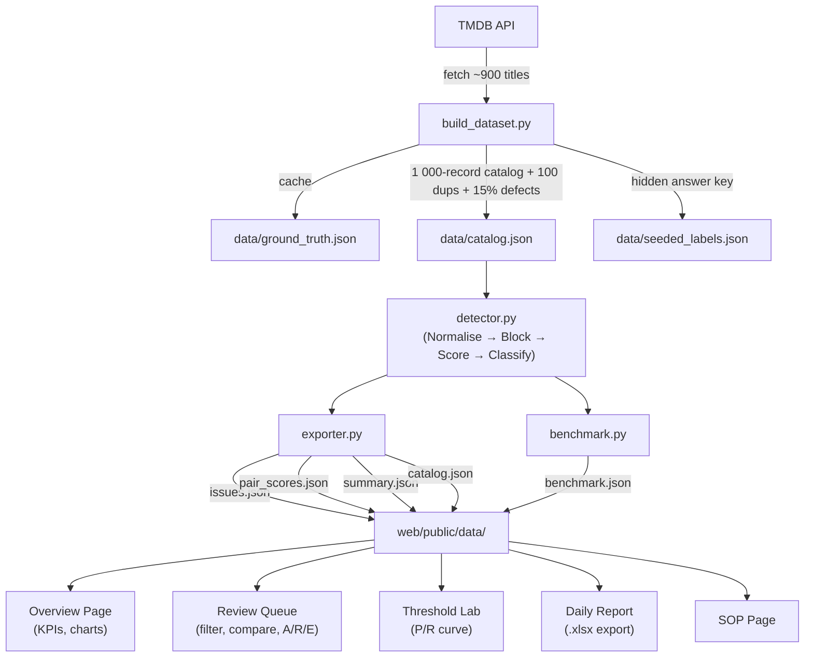

# FireTV Catalog Quality Checker

> An advanced content-catalog QA tool that detects duplicates and metadata errors in streaming catalogs and presents them in a reviewer dashboard.

*This product uses the TMDB API but is not endorsed or certified by TMDB.*

---

## Architecture



---

## Setup

### Prerequisites

- Python 3.10+ (tested on 3.10)
- Node.js 18+
- A TMDB API key (create one at [themoviedb.org](https://www.themoviedb.org/settings/api))

### 1. Clone and configure

```bash
git clone https://github.com/ABIMANYU72/FireTV-Catalog-Quality-Checker.git
cd "FireTV Catalog Quality Checker"

# Add your TMDB key
echo TMDB_API_KEY=your_key_here > .env
```

### 2. Install Python dependencies

```bash
pip install pandas rapidfuzz requests openpyxl pytest python-dotenv tqdm unidecode
```

### 3. Run the full pipeline (one command)

```bash
python run_pipeline.py
```

This fetches ~900 TMDB titles (cached on subsequent runs), builds the 1 000-record catalog with 100 seeded duplicates and ~15% metadata defects, runs detection, and writes all JSON artifacts to `web/public/data/`.

**Offline mode:** If `TMDB_API_KEY` is not set but `data/ground_truth.json` exists, the pipeline runs fully offline.

### 4. Start the dashboard

```bash
cd web
npm install
npm run dev
```

Open [http://localhost:3000](http://localhost:3000).

### 5. Run tests

```bash
cd engine
pytest tests/ -v
```

---

## Results

> Numbers below are generated automatically from `data/benchmark.json` and `web/public/data/summary.json`. Run `python run_pipeline.py` to reproduce.

| Metric | Value |
|--------|-------|
| Catalog records | 1 000 |
| Seeded duplicates | 100 |
| Metadata defect rate | ~15% |
| Seeded dups detected | *see summary.json* |
| Precision | *see summary.json* |
| Recall | *see summary.json* |
| F1 | *see summary.json* |
| Detection time | *see benchmark.json* |
| Comparisons saved vs n² | *see benchmark.json* |
| Speedup vs manual (ESTIMATE) | *see benchmark.json* |

> ⚠️ Manual baseline figures are **ESTIMATES** based on industry norms (10 s/record review + 30 min manual report). They are clearly labelled in `benchmark.json` and the dashboard.

---

## Stack

| Layer | Technology |
|-------|-----------|
| Detection engine | Python 3.10, pandas, rapidfuzz, requests, unidecode |
| Tests | pytest (15+ tests) |
| Report export | openpyxl |
| Dashboard | Next.js 14 (App Router), TypeScript, Tailwind CSS |
| Charts | Recharts |
| Excel export | SheetJS (xlsx) |
| Icons | Lucide React |
| UI primitives | shadcn/ui |
| Deployment | Vercel (root `/web`, no env vars required) |

---

## Detection Pipeline

1. **Normalise** – transliterate Unicode, lowercase, strip punctuation, drop leading/trailing articles, convert Roman numerals and number words, strip parenthetical years
2. **Block** – inverted index on 4-char prefix; year-window filter (±2 years) eliminates >95% of n² comparisons
3. **Score** – weighted blend:

| Signal | Weight |
|--------|--------|
| token_set_ratio | 35% |
| WRatio | 25% |
| year_proximity | 15% |
| language_match | 10% |
| runtime_closeness | 8% |
| cast_overlap | 7% |

4. **Classify** – `composite ≥ 0.82` → AUTO_FLAG · `≥ 0.65` → NEEDS_REVIEW · else DISTINCT
5. **Categorise** – each issue is typed as one of 4 SOP categories

---

## Issue Categories (SOP)

| Category | Description |
|----------|-------------|
| `DUPLICATE` | Same content, separate entries |
| `MISSING_METADATA` | Required field absent or empty |
| `METADATA_MISMATCH` | Field value differs from TMDB authoritative source |
| `INVALID_FORMAT` | Field present but syntactically/semantically invalid |

See [docs/SOP.md](docs/SOP.md) for full definitions, severity levels, and SLAs.

---

## Dashboard Pages

| Page | Path | Description |
|------|------|-------------|
| Overview | `/` | KPI cards, issues-by-category chart, P/R/F1, time savings |
| Review Queue | `/review` | Filterable issue list, side-by-side compare, A/R/E actions |
| Threshold Lab | `/threshold` | Slider to recompute P/R live, PR curve |
| Daily Report | `/report` | One-click `.xlsx` export with generation timer |
| SOP | `/sop` | Rendered `docs/SOP.md` |

Keyboard shortcuts on Review Queue: **J**/**K** navigate · **A** accept · **R** reject · **E** escalate.

---

## Limitations

1. **Alternate-language titles** not in the known mapping may be missed as duplicates.
2. **METADATA_MISMATCH** detection requires TMDB API access; offline mode detects only MISSING_METADATA and INVALID_FORMAT.
3. **Remakes in the same year** pass the year-window filter and appear in NEEDS_REVIEW — manual review required.
4. **Cast enrichment** may miss titles without crew data in TMDB.
5. **Evaluation depends on seeded labels** — precision/recall is measured against the 100 injected duplicates only.

---

## Reproducing Results

```bash
# Fresh run with a different random seed (change SEED in build_dataset.py)
python engine/build_dataset.py
python engine/exporter.py
python engine/benchmark.py
```

The detector **never reads** `data/seeded_labels.json` during detection; labels are only used in the evaluation step after detection completes.

---

## Vercel Deployment

Root directory: `/web`  
No environment variables required (all data is static JSON).

[](https://vercel.com/new/clone?repository-url=https://github.com/ABIMANYU72/FireTV-Catalog-Quality-Checker)
